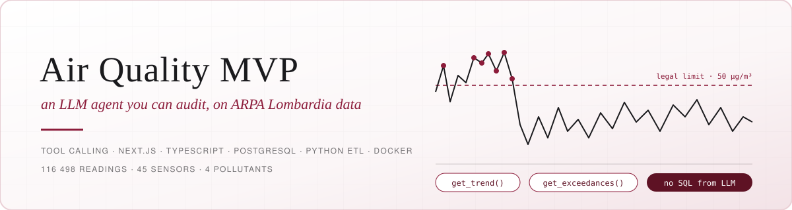
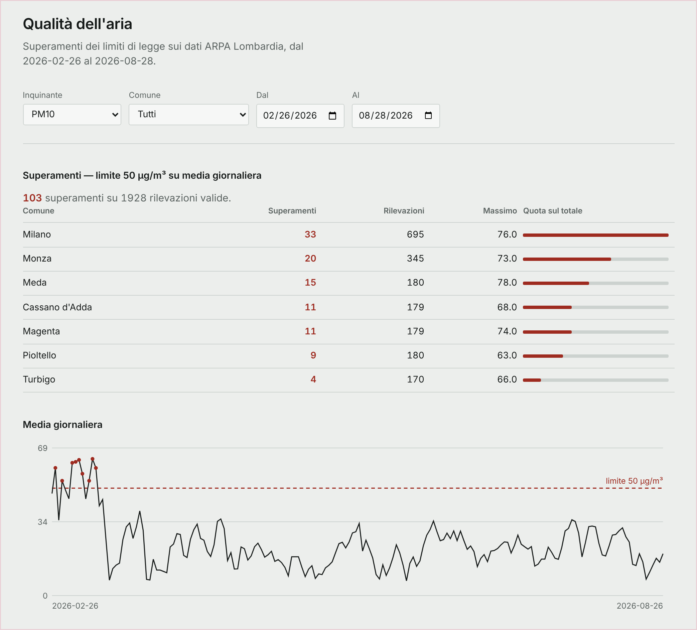
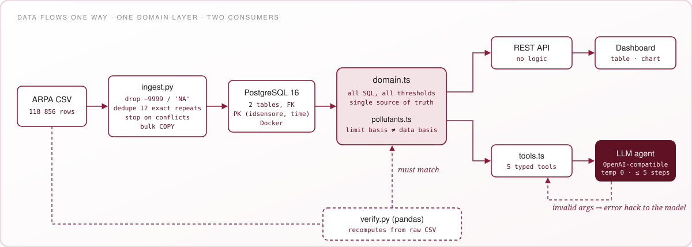
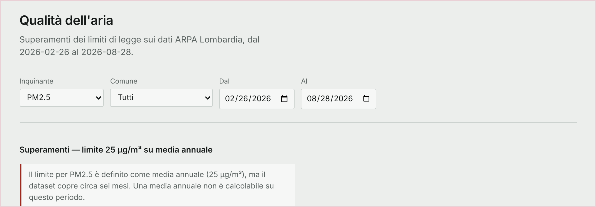
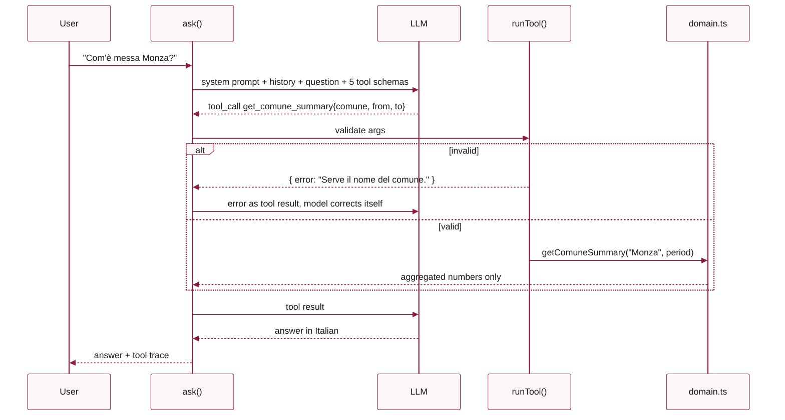
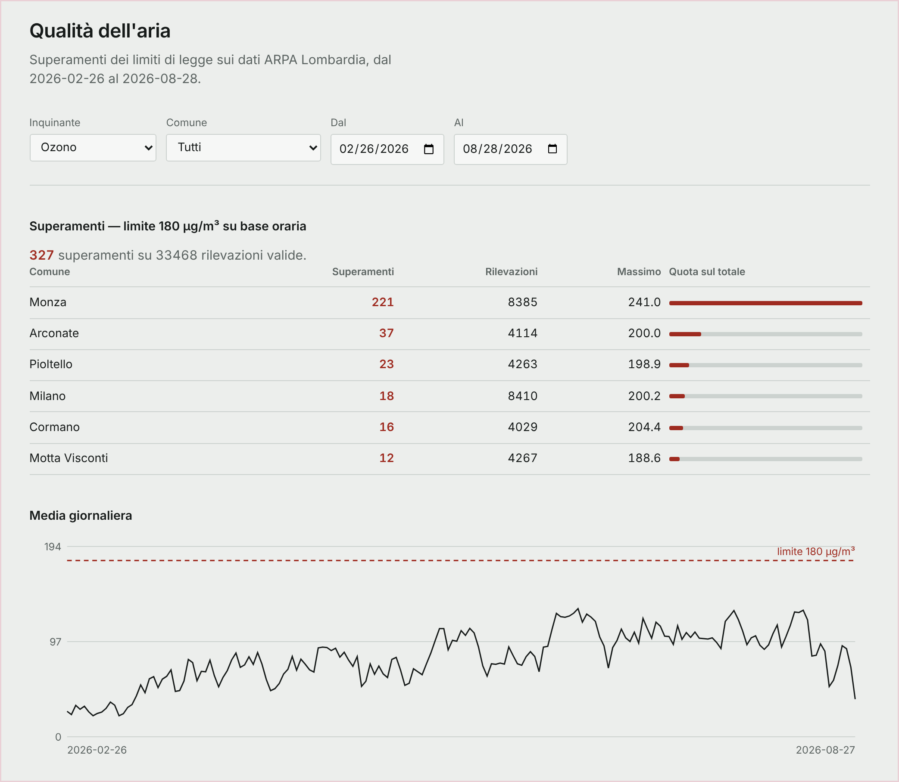

<p align="center">
  
</p>

<p align="center">
  
  
  
  
  
  
  
</p>

<p align="center"><i>
How often were the legal limits exceeded, where, and how did it evolve?<br>
You can read the answer on a dashboard or ask for it in plain Italian, and both give the same number.
</i></p>

---

## ✦ Contents

- [What it is](#-what-it-is)
- [Architecture](#-architecture)
- [The data is messier than it looks](#-the-data-is-messier-than-it-looks)
- [The assistant: tool calling, not text-to-SQL](#-the-assistant-tool-calling-not-text-to-sql)
- [Verification](#-verification)
- [Results](#-results)
- [Run it](#-run-it)
- [Repository layout](#-repository-layout)

---

## ✦ What it is

A full-stack tool over six months of **ARPA Lombardia** air-quality measurements (PM10, PM2.5, NO₂, O₃; 45 sensors;
26 Feb – 27 Aug). It has two ways in:

- a **dashboard** with pollutant, comune and date filters, a per-comune exceedance table and a daily-mean chart against the legal limit
- an **assistant** you can ask questions in Italian. It answers by calling typed tools, so it never writes SQL and never sees the database.

<p align="center">
  <br>
  <sub><b>PM10.</b> 103 exceedances out of 1 928 valid readings, ranked by comune. Daily means above the 50 µg/m³ limit are marked in red.</sub>
</p>

---

## ✦ Architecture

<p align="center">
  
</p>

Data flows **in one direction only**, and every number passes through a single domain layer:

| Layer | File | Responsibility |
|:--|:--|:--|
| Ingest | `ingest/ingest.py` | Cleans the CSVs and bulk-loads them. Runs once. |
| Schema | `db/schema.sql` | `sensors`, `measurements`, PK on `(idsensore, measured_at)`, indexes on time and `(pollutant, comune)` |
| Domain | `src/lib/domain.ts` | **All the SQL and all threshold logic.** Nothing else talks to the database. |
| Configuration | `src/lib/pollutants.ts` | Limits and time bases. No DB access, so it is unit-testable on its own. |
| API | `src/app/api/*` | Exposes the domain over HTTP, with validation and no business logic |
| UI | `src/components/*` | Filters, exceedance table, SVG trend chart, chat |
| Assistant | `src/lib/tools.ts`, `assistant.ts` | Tool calling on top of the same domain functions |

> [!IMPORTANT]
> **Why do the page and the assistant both go through the domain?** If each wrote its own queries, sooner or later they
> would give two different numbers for the same question. That is unacceptable in a tool meant for an official report.
> With one source of truth, a fix to an aggregation reaches both consumers at the same moment.

---

## ✦ The data is messier than it looks

Four details in the source data would each have quietly produced wrong numbers.

<table>
<tr><td width="34"><b>1</b></td><td>

**Granularities do not match.** NO₂ and O₃ are **hourly** (~24 readings/day/sensor), PM10 and PM2.5 are **daily**, and the
legal limits are defined on their own time bases. A single aggregation function would be wrong for half the pollutants.
So `pollutants.ts` stores `limitBasis` and `dataBasis` as **separate fields**, and `comparisonMode()` decides between
`direct`, `aggregate` and `not-computable` before any SQL runs.

</td></tr>
<tr><td><b>2</b></td><td>

**Missing values are `-9999` with `stato = 'NA'`.** There are 2 346 of 118 856 records. They are dropped **at ingest**, so `measurements`
can never hold a value that must not be averaged, and no query downstream has to remember a `WHERE` clause. A single
forgotten filter would shift a mean by thousands of units with no warning.
The CSV is read with Python's `csv` module, not pandas, because pandas turns the string `NA` into `NaN` and the rows to
reject disappear before they are seen.

</td></tr>
<tr><td><b>3</b></td><td>

**Twelve exact repeats.** There are 12 `(sensor, timestamp)` pairs with identical values, clustered at two instants, which points to an upstream
batch being re-emitted. They were not spotted during exploration. The **primary key rejected them** on the first load.
They are deduplicated at ingest and the constraint stays in place, since it is what caught them. If two rows ever share a key
with **different** values, ingest **stops with an error**, because choosing one would mean inventing data.

</td></tr>
<tr><td><b>4</b></td><td>

**The PM2.5 limit cannot be computed here.** It is an **annual** mean (25 µg/m³) and the dataset covers six months.
The app returns `computable: false` with a reason instead of a number that would look official, both in the UI and in the assistant's answers.

</td></tr>
</table>

<p align="center">
  <br>
  <sub>For PM2.5 the dashboard explains why there is no number instead of showing one.</sub>
</p>

---

## ✦ The assistant: tool calling, not text-to-SQL

The model **never sees the database and never writes SQL**. It chooses which tool to call and with which arguments.
The numbers come back from the domain layer, and the model only phrases them.

| Tool | Backed by | Purpose |
|:--|:--|:--|
| `get_metadata` | `getMetadata()` | Available comuni and the actual period covered. Called first when no period is given. |
| `get_exceedances` | `getExceedances()` | Readings above the limit per comune |
| `get_trend` | `getTrend()` | Daily-mean series for trend questions |
| `get_comune_summary` | `getComuneSummary()` | Mean, max and exceedances for every pollutant in one comune |
| `get_stations` | `getStations()` | Which station measures what, and where |



**Why not let the model generate SQL?** On a small dataset text-to-SQL works almost every time, and that is the problem.
When it fails it produces a **plausible number instead of an error**, and the reader has no way to notice. With typed tools:

- **The set of possible actions is closed.** Pollutants are an `enum`, dates are validated, unknown tools are rejected.
- **Errors make the model correct itself instead of crashing the request.** `runTool()` turns bad arguments into an error message the model can read.
- **Answers can be audited.** The UI shows which tools produced each answer.
- **Cost per question is constant.** Only aggregated results enter the context, never raw rows.
- **The design extends easily.** A new capability is one entry in `tools.ts` plus one domain function.

**Loop details** (`assistant.ts`): plain `fetch` against any **OpenAI-compatible** endpoint (about twenty lines, no SDK lock-in),
`temperature: 0`, at most **5 steps** so a malformed conversation cannot loop forever, and a system prompt that
requires every number to come from a tool.

> [!TIP]
> **The model is an environment variable**, not a constant in the code. During development the chosen model was retired by the provider,
> and replacing it took one line in `.env` and zero code changes.

---

## ✦ Verification

Aggregation errors are invisible: the result always *looks* right. So correctness is checked along a second, independent path.

| Check | How | Status |
|:--|:--|:--|
| Pure logic | `vitest`: sensor-type strings, time-base comparison, the PM2.5 refusal, validation of model-supplied keys | ✅ 6 / 6 |
| Types | `tsc --noEmit` | ✅ |
| SQL aggregations | `ingest/verify.py` recomputes the same figures with **pandas, directly from the CSVs**, without touching the DB, using the same deduplication | ✅ matches the API |

One test does more than it looks: it pins the exact `nometiposensore` strings. If ARPA renames a sensor type, every query
would silently return zero rows, and this test makes that failure loud.

---

## ✦ Results

Whole period, the three pollutants for which the limit is computable:

| Pollutant | Limit | Valid readings | Exceedances | Max | Worst comuni |
|:--|:--|--:|--:|--:|:--|
| **PM10** | 50 µg/m³, daily | 1 928 | **103** | 78.0 | Milano 33 · Monza 20 · Meda 15 |
| **O₃** | 180 µg/m³, hourly | 33 468 | **327** | 241.0 | Monza 221 · Arconate 37 · Pioltello 23 |
| **NO₂** | 200 µg/m³, hourly | 79 906 | **0** | 147.6 | — |
| **PM2.5** | 25 µg/m³, annual | — | not computable | — | dataset covers six months |

<p align="center">
  <br>
  <sub><b>Ozone.</b> The daily mean rises through spring into summer. Monza alone accounts for 221 of the 327 hourly exceedances.</sub>
</p>

---

## ✦ Run it

```bash
docker compose up -d                       # PostgreSQL 16
pip install -r ingest/requirements.txt
python ingest/ingest.py                    # load the CSVs into the database

cp .env.example .env                       # then set LLM_API_KEY
npm install
npm run dev                                # http://localhost:3000
```

The assistant uses any **OpenAI-compatible** endpoint. `.env.example` points to Groq, which has a free tier that does not ask for a card.
**The dashboard works without a key**. Only the assistant needs one.

```bash
npm run test               # pure logic
npm run typecheck
python ingest/verify.py    # recompute the same numbers with pandas
```

| Variable | Default |
|:--|:--|
| `DATABASE_URL` | `postgresql://aq:aq@localhost:5432/airquality` |
| `LLM_BASE_URL` | `https://api.groq.com/openai/v1` |
| `LLM_MODEL` | `llama-3.3-70b-versatile` |
| `LLM_API_KEY` | *(required for the assistant only)* |

<details>
<summary><b>Note on dependencies</b></summary>
<br>

Next.js and React are on the December 2025 security-patched releases (15.5.25 / 19.1.9). The project started on a version later found to be vulnerable and was upgraded during development.
`npm audit` still reports `postcss`, a transitive dependency of Next.js. The advisories concern CSS generation and automatic source-map loading from untrusted
input. This project has a single static stylesheet, so that path does not exist. The only fix today is Next 16, a breaking major, which on a prototype is a bigger risk than the advisory.

</details>

---

## ✦ Repository layout

```text
air-quality-mvp/
├── data/                    # ARPA CSVs: stations.csv, measurements.csv
├── db/schema.sql            # 2 tables, PK + FK, indexes
├── ingest/
│   ├── ingest.py            # clean → dedupe → COPY
│   └── verify.py            # independent pandas recomputation
├── src/
│   ├── lib/
│   │   ├── domain.ts        # the only place with SQL
│   │   ├── pollutants.ts    # limits & time bases (pure)
│   │   ├── tools.ts         # 5 tool schemas + validated dispatcher
│   │   ├── assistant.ts     # tool-calling loop (plain fetch)
│   │   ├── db.ts · http.ts
│   ├── app/api/             # metadata · exceedances · trend · stations · chat
│   └── components/          # Dashboard · TrendChart · Assistant
├── tests/pollutants.test.ts
├── docs/                    # banner, architecture, screenshots
└── docker-compose.yml
```

---

<p align="center">
  <sub><b>Golsa Shokri</b> · Next.js · PostgreSQL · Python · LLM tool calling</sub>
</p>
